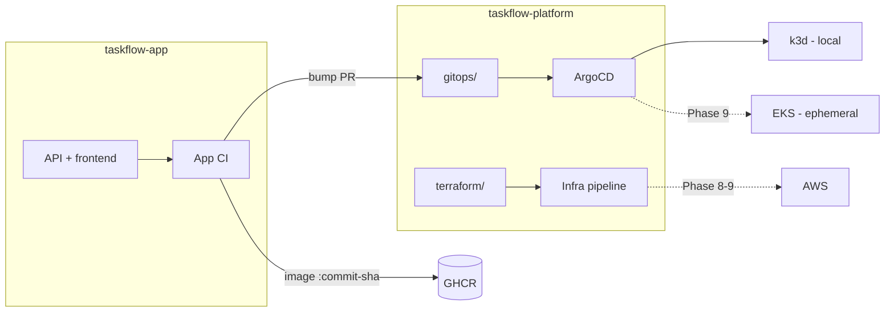

# taskflow-platform

Platform repository for **TaskFlow**, a lab that runs a small application on Kubernetes using
production-style practices: infrastructure as code, CI/CD, GitOps, observability, a security
baseline and documented reliability exercises.

Application source lives in [`taskflow-app`](https://github.com/TavoA2/taskflow-app).
This repository holds everything about *where and how* it runs. Why two repos: [ADR-0001](docs/adr/0001-repo-structure.md).



## Status

Statuses are explicit: **Implemented** (exists in the repo), **Tested** (verified, with evidence linked),
**Planned** (not started). Nothing is claimed beyond its evidence.

| Phase | Scope | Status |
|-------|-------|--------|
| 0 | Repos, conventions, pinned tools, ADR-0001/0002, `make bootstrap` | Implemented, Tested ([evidence](docs/test-results/phase-0-workstation.md)) |
| 1 | App in containers (compose, migrations, tests) | Implemented, Tested ([evidence](docs/test-results/phase-1-app-in-containers.md)) |
| 2 | App CI (scan, SBOM, GHCR) | Implemented, Tested ([evidence](docs/test-results/phase-2-app-ci.md), [ADR-0005](docs/adr/0005-app-ci-and-supply-chain.md)) |
| 3 | Kubernetes on k3d (workloads, Gateway API, probes) | Planned |
| 4 | GitOps with ArgoCD | Planned |
| 5 | Security baseline (RBAC, NetworkPolicies, secrets) | Planned |
| 6 | Observability (Prometheus, Grafana, alerts) | Planned |
| 7 | Reliability exercises with reports | Planned |
| 8 | Terraform for AWS (plan only) | Planned |
| 9 | AWS ephemeral sessions (requires explicit budget approval) | Planned |

## Layout

| Path | Purpose | Status |
|------|---------|--------|
| `docs/adr/` | Architecture Decision Records | Implemented |
| `scripts/bootstrap.sh` | Read-only workstation check used by `make bootstrap` | Implemented |
| `.tool-versions` | Pinned tool versions (asdf/mise format) | Implemented |
| `k3d/taskflow-local.yaml` | Local cluster as code (`make cluster-up`) | Implemented (Phase 3) |
| `.github/workflows/ci.yml` | `validate` (required check) and secrets scan | Implemented (Phase 3) |
| `platform/` | Cluster add-ons: Envoy Gateway values, shared Gateway, Gateway smoke test (ADR-0006) | Implemented (Phase 3) |
| `gitops/base/` | Application manifests: namespace (Pod Security `restricted`), PostgreSQL, migrate Job (ADR-0007) | Implemented (Phase 3, in progress) |
| `gitops/overlays/local/` | Local overlay: pinned images, git-ignored credentials (`make local-secrets`) | Implemented (Phase 3, in progress) |
| `gitops/` (ArgoCD, `ec2` / `aws` overlays) | ArgoCD Applications and further overlays | Planned (Phases 4, 8-9) |
| `terraform/` | Modules and `envs/` | Planned (Phase 8) |
| `docs/test-results/` | Test evidence per phase | Implemented (Phases 0-2) |
| `.github/rulesets/main.json` | Branch protection of `main` as code (`make ruleset`, `make ruleset-check`) | Implemented |
| `docs/runbooks/` | Operational runbooks | Planned (Phase 7) |

## Prerequisites

Windows 11 + WSL2 (Ubuntu) + Docker Desktop with WSL integration enabled for the distro.
Work inside the WSL filesystem (`~/code/...`), not under `/mnt/c`.

| Tool | Version | Install (Ubuntu) |
|------|---------|------------------|
| docker | managed by Docker Desktop | Docker Desktop > Settings > Resources > WSL integration |
| git, make, curl, jq | distro packages | `sudo apt-get install -y git make curl jq` |
| kubectl | see `.tool-versions` | <https://kubernetes.io/docs/tasks/tools/install-kubectl-linux/> |
| k3d | see `.tool-versions` | `curl -fLo /tmp/k3d https://github.com/k3d-io/k3d/releases/download/v5.9.0/k3d-linux-amd64 && sudo install -m 0755 /tmp/k3d /usr/local/bin/k3d` |

## Usage

```bash
make help           # list targets
make bootstrap      # verify the workstation; exit code 0 = READY
make validate       # actionlint + kustomize build | kubeconform (Kubernetes 1.36 schema, strict)
make secrets-scan   # gitleaks over the full git history
make ruleset-check  # fail if the live branch protection differs from .github/rulesets/main.json
make cluster-up     # create/start the local k3d cluster (k3d/taskflow-local.yaml)
make cluster-status # nodes and system pods
make cluster-down   # delete the cluster and its volumes
make platform-install  # Envoy Gateway (pinned chart, Gateway API CRDs v1.6.1) + shared Gateway
make gateway-smoke     # route a throwaway backend through http://127.0.0.1:8088, then remove it
make local-secrets     # create the git-ignored database credentials (once)
make deploy            # apply gitops/overlays/local and run database migrations
```

Local cluster: k3s v1.36.5, 1 server + 2 agents, Traefik disabled (Envoy Gateway replaces it). The Kubernetes
API listens on `127.0.0.1:6445` and the Gateway on `127.0.0.1:8088`. Make targets always pass
`--context k3d-taskflow`; your current kubectl context is never changed or used.

Changes to `main` go through pull requests only (squash merge, no force push, no bypass).

## Conventions

- Everything is declared in Git; no manual changes to clusters.
- Environment differences live only in overlays; no machine-specific paths or names.
- Images are tagged by commit SHA; `latest` is never used.
- Secrets are never committed (see `.gitignore`); encrypted secrets only, from Phase 5.
- Documentation, diagrams (Mermaid) and ADRs are written in English.
