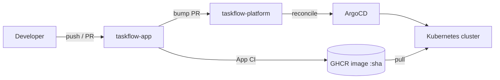

# ADR-0001: Two repositories: application and platform

- Status: Accepted
- Date: 2026-10-27

## Context

TaskFlow is a lab that reproduces enterprise delivery practices: application CI, infrastructure as code,
and GitOps-based continuous delivery. These three concerns have different change rates, reviewers,
permissions and pipelines. In GitOps, the repository that the cluster reconciles from is the source of
truth for what runs; mixing it with application source means every code commit can trigger
reconciliation noise and that CI needs write access to the deployment state.

## Decision

Use two repositories:

| Repository | Contents | Pipelines |
|------------|----------|-----------|
| `taskflow-app` | API (Go) and frontend source, Dockerfiles, tests | App CI: lint, test, build, scan, SBOM, push image to GHCR tagged by commit SHA |
| `taskflow-platform` | `terraform/` (modules + `envs/`), `gitops/` (manifests, ArgoCD Applications, overlays `local`, `ec2`, `aws`), `docs/` (ADRs, runbooks, test results) | Infrastructure (fmt/validate/plan/apply with approval) and GitOps/CD |

A new application version reaches a cluster only through a reviewable change (pull request) in
`taskflow-platform` that bumps the image tag. ArgoCD watches `taskflow-platform` only.

## Alternatives considered

- **Monorepo** (app + infra + manifests). Simpler for one person and atomic cross-cutting changes, but
  ArgoCD would watch a repo with constant code churn, CI would need write access to deployment state,
  and permission boundaries (who can change prod infra vs app code) cannot be separated by repository.
- **Three repositories** (app, terraform, gitops). Cleaner separation of infra and manifests, but more
  overhead than a one-person lab justifies; the two are separated by directory and pipeline path filters instead.

## Consequences

- Positive: clear audit trail of what is deployed (Git history of `taskflow-platform`); rollback is a
  Git revert; least-privilege permissions per repo; mirrors common enterprise layouts.
- Negative: a feature that needs code and config changes requires two PRs; the image-bump automation
  needs a cross-repo credential (GitHub App or fine-grained token, decided in Phase 4); documentation
  lives in `taskflow-platform`, so `taskflow-app` links to it.

## Verification

- Both repositories exist and each `README.md` links to the other.
- Phase 4 exit evidence: an image version change reaches the cluster only through a merged PR in `taskflow-platform`.
