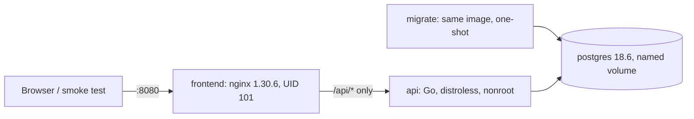

# Phase 1 - Application in containers

- Date: 2026-10-27
- Result: **PASS** (all exit criteria met)
- Application commit: `taskflow-app@d97bb2a1dd65` (images tagged `d97bb2a1dd65`). The smoke and persistence
  scripts were added afterwards in the commit that introduced them; the evidence run verified that `api/`,
  `frontend/` and `compose.yaml` were unchanged from `d97bb2a`, so the images match that commit exactly.
- Environment: Windows 11 + WSL2 (Ubuntu 26.04, kernel 6.18.33.2), Docker Engine 29.6.2, Compose 5.3.1, Go 1.27.3
- Raw output: [phase-1-app-in-containers.log](phase-1-app-in-containers.log)

## Exit criteria

| Criterion | Evidence | Result |
|-----------|----------|--------|
| Tests green | 82 test cases counting subtests (62 unit, 20 integration), 0 failures | PASS |
| CRUD works end to end | Smoke test through the frontend: 20/20 checks | PASS |
| Data survives restart | Same task (all fields and timestamps) after a PostgreSQL restart and after `compose down` + `up` | PASS |

## What was run

All runs used a separate compose project (`taskflow-evidence`) with its own volume, started from an empty
database and removed afterwards. The developer's `taskflow_pgdata` volume was not touched.

### 1. Static checks and tests

| Check | Result |
|-------|--------|
| `gofmt` | No unformatted files |
| `go vet` (default and `integration` tags) | No findings |
| Unit tests (`make test`, no Docker) | 62 passed, 0 failed |
| Unit + integration (`make test-integration`, 22 s) | 82 passed, 0 failed |

Statement coverage with integration tests:

| Package | Coverage |
|---------|----------|
| `task` (domain and validation) | 100.0% |
| `config` | 94.7% |
| `httpapi` (handlers, middleware, probes, metrics) | 94.4% |
| `store` (PostgreSQL) | 92.5% |
| `migrations` | 78.0% |

Coverage alone does not show that tests detect defects. During development every step was also checked by
**mutation**: a deliberate bug was introduced in a throwaway copy and the suite had to fail. Examples that the
final suite catches: disabling status validation, leaking internal errors to clients, using the raw URL path as a
metric label, removing panic recovery from the router, readiness ignoring shutdown, a read-modify-write partial
update (lost updates, detected in 98-100 of 100 tasks per run), removing the migration advisory lock.
Weak tests found this way were fixed before this run (see "Findings").

### 2. Cold start

`docker compose up -d --build --wait` from an empty volume: exit 0 in 26 s including image builds.
Start order respected: `postgres` healthy → `migrate` exited 0 (migration 00001 applied in 7 ms) → `api` healthy →
`frontend` healthy.

### 3. Smoke test - `scripts/smoke-test.sh` (20/20)

Runs only against the public entry point, so it is reusable as post-deploy verification on Kubernetes.

| Group | Checks |
|-------|--------|
| Frontend | Page served, assets served, CSP restricts scripts to same origin, `nosniff` header |
| API through the proxy | List, create (201 + `Location`), default status, get, patch, validation error 400, unknown 404, `X-Request-ID` echoed end to end, delete 204, deleted task 404 |
| Exposure | `/metrics`, `/readyz`, `/healthz` return 404 through the frontend |

### 4. Persistence test - `scripts/persistence-test.sh`

| Step | Result |
|------|--------|
| Create a task, record its full JSON | `01a17eaa-8557-…` |
| `docker compose restart postgres` | Task identical (id, title, description, status, `created_at`, `updated_at`) |
| `docker compose down` (0 containers left) then `up --wait` | Task identical; same volume (same creation timestamp) |

Control experiment: after `docker compose down -v` (volume removed) and `up`, a previously created task returns
404. The data lives in the named volume, not in the containers.

The scripts were themselves checked for false positives before this run: the smoke test fails against the API
debug port (7 failures, including exposed internal endpoints) and against an unreachable address (20 failures);
the persistence test fails in both phases when PostgreSQL keeps its data on `tmpfs` instead of a volume.

### 5. Additional behaviour verified

| Scenario | Observed | Why it matters |
|----------|----------|----------------|
| PostgreSQL stopped | `/readyz` 503 `database: down`, `/healthz` 200, UI 200, `/api` 500 | An orchestrator stops routing to the API but does not restart it: no restart storm during a database outage |
| PostgreSQL started again | `/readyz` 200 after ~2 s, API restart count 0 | The connection pool recovers without a restart |
| API SIGTERM | At +1.5 s: `/readyz` 503, `/healthz` 200, requests through nginx still 200; stopped in 5.5 s, exit 0 | Drain before close: no dropped requests during rolling updates |
| Images | API 6.3 MB compressed, `nonroot`; frontend 25.6 MB compressed, UID 101 | Small attack surface, no root processes |
| Logs | Database password absent from every container log | Credentials are never logged |
| After all disruptions | Smoke test 20/20 | System returns to a healthy state |

Verified in earlier steps of this phase (same code paths, not re-run here): request ID correlation between nginx
and API logs, nginx re-resolving the API after its IP changed without a restart, 413 for bodies over 64 KB,
HTML/script injection rendered as text in the browser and inline scripts blocked by the CSP.

## Findings fixed during Phase 1

| Finding | How it was found | Fix |
|---------|------------------|-----|
| `migrate` could fail on a cold start | Intermittent `Exited (1)` in an end-to-end run; mechanism confirmed in the image entrypoint (temporary init server listens on the Unix socket only) | PostgreSQL health check over TCP; `migrate` retries the first connection for up to 30 s |
| Duplicate `version` key in migration logs | Reading JSON logs during verification | Distinct keys (`migration`, `schema_version`) |
| Lost-update test detected the bug only 1 time in 3 | Mutation testing | One write per field across 100 tasks, released by a barrier |
| Advisory-lock removal went unnoticed | Mutation testing | Deterministic test that holds the lock and asserts `migrate up` waits |
| Panic-recovery removal went unnoticed | Mutation testing | Test through the production router |
| Two mutants "killed" by compile errors, not tests | Inspecting mutation output | Mutation script rejects mutants that do not compile |

## Limitations (not covered by this evidence)

- Single host, single replica of each service: these results show application behaviour, not high availability.
- Docker named volume on the local disk: data survives container restarts and recreation, not loss of the host or disk.
- No backup or restore yet (Phase 7).
- `sslmode=disable` between API and database: acceptable only on the local compose network.
- The Go race detector has not run (no C toolchain on the workstation); planned for CI in Phase 2.
- The frontend has no automated browser tests; it was verified manually in a browser.
- Base images are pinned by tag, not by digest.
